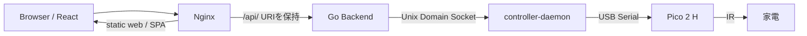
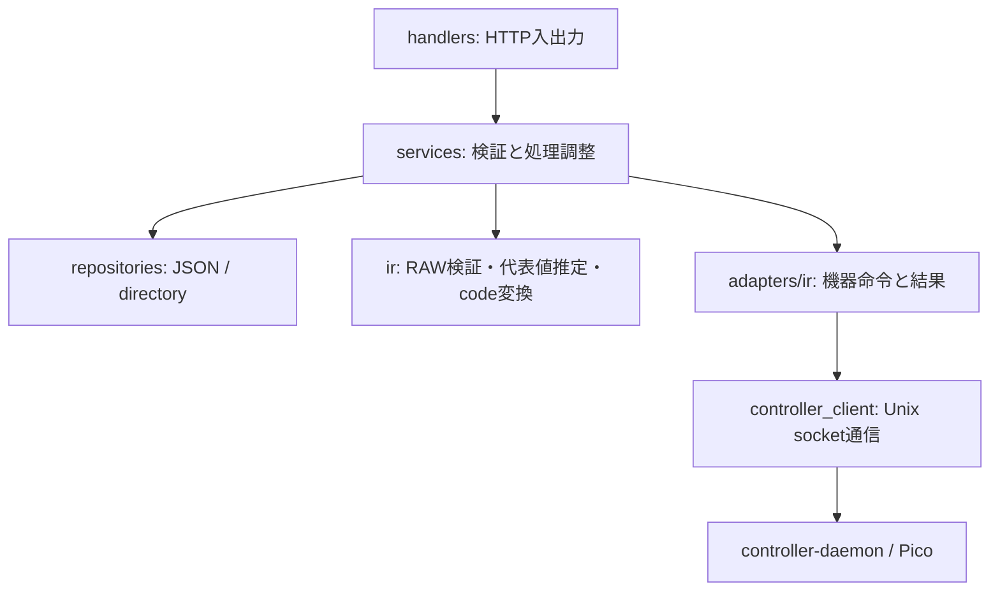
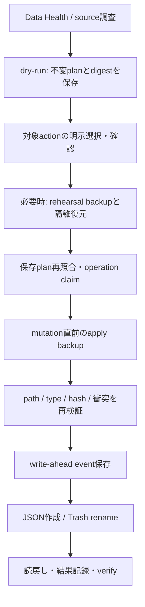

# Architecture

Home Controllerの現行構成と処理の責務を示します。HTTPの正本は[API](API.md)、保存形式は[DATA_SCHEMA](DATA_SCHEMA.md)、条件付きSchemaの評価は[STATEFUL_SCHEMA](STATEFUL_SCHEMA.md)です。将来のAdapterや共通Capabilityは[ROADMAP](../ROADMAP.md)で扱います。

## 全体構成

| component | 責務・入口 |
|---|---|
| [frontend](../frontend/src/App.tsx) | React/TypeScript。Homeの日常操作、Room/Device設定、Maintenance、Trash、情報表示 |
| [Backend](../backend/main.go) | 単一のGo binary。HTTP、永続化、Schema検証、IR操作、保守の調整。別databaseやqueueは使わない |
| [共通config](../config/config.go) | Backend/daemonが先頭の`--config`で同じ設定を読み、配置・待受・socket・Picoの境界を検証 |
| [controller-daemon](../controller-daemon/main.go) | Unix socketで命令を受け、USB Serialへ直列化してPicoのJSON応答を返す |
| [Pico firmware](../pico-firmware/bedroom-usb/main.cpp) | USB stdioで行単位の命令を処理し、IR送受信や対応capabilityを提供 |
| Nginx / systemd | 静的webの配信、SPA fallback、loopback APIへのproxy、専用userでのprocess管理 |

FrontendのHomeは`/`、部屋の直接URLは`/rooms/:roomId`で、Deviceは`?device={deviceId}`で選択できます。設定は`/settings`、保守は`/maintenance`、Trashは`/trash`に分けます。旧`/web-controller`はHomeへredirectします。APIの404をSPAのHTMLに置き換えない配置にします。

## 起動と配置

通常起動ではconfigを読み、`data_root/rooms`をRoom/Device/IR repositoryへ、保守rootを各storeへ、`socket_path`をcontroller clientへ注入します。Backendの待受はconfigで指定するloopback addressです。標準値は`127.0.0.1:3000`、socketは`/run/web-controller/controller-daemon.sock`です。個々のrepositoryの既定値を設置先の選択方法として使いません。

標準配置はsoftwareが`/opt/web-controller/current`、configが`/etc/web-controller/config.json`、data/maintenance/backups/trashが`/var/lib/web-controller/`配下です。保護root間の非重複、所有者・mode・symlink制約、data/Trash同一filesystemを維持します。設定keyと権限は[examples/README](../examples/README.md)、設置は[INSTALL](../INSTALL.md)を参照してください。

daemon→Backendの順に起動します。systemdのWants/AfterはPicoの準備完了を保証せず、daemon/Picoが不通でもBackendの通常data APIは利用できます。保守storeの準備や起動時照合に失敗した機能は利用不可として停止し、機器/保守がすべて利用可能であるとhealthから推測しません。

## Room / Device / IR Adapter

Roomは部屋、Deviceは機器の識別・表示・主操作方式を持ちます。IR固有dataはDeviceの`adapters/ir`に置き、`primary_adapter`と`ir_remote_type`を使って操作を選びます。ボタン型はCommand、状態全体を送る機器はStateとState Schemaで管理します。Adapterの保存識別子と実装済みの操作能力は別です。

Stateの値は登録信号の意味を表し、SchemaからIR波形を自動生成しません。code形式のBackend encoderはprotocol/codeをRAWへ変換しますが、Stateの温度やmodeから任意のcodeを生成するものではありません。家電の実状態取得は現行IR操作に含みません。

## Backend packageの責務

| package | 責務 |
|---|---|
| [handlers](../backend/handlers) | route/method dispatch、JSON入力境界、service呼出し、HTTP status/JSON応答 |
| [models](../backend/models) | 保存・要求・応答と内部処理の共有型。HTTPの書込みDTOと保存型は省略値を扱うため分離 |
| [services](../backend/services) | ID/型/Schema/format検証、操作計画、IR送信、Backup/Trash/保守の処理順 |
| [repositories](../backend/repositories) | 設定root以下のpath解決、JSON/metadataの保存・読込、snapshot・Trash境界 |
| [ir](../backend/ir) | RAW timings検証、captureからの代表timings推定、PANASONIC_40 encoder |
| [adapters/ir](../backend/adapters/ir) | capture、RAW/code/presetの機器命令への変換、型付き通信結果 |
| [controller_client](../backend/controller_client) | socket通信、接続/通信deadline、write進捗と失敗段階、remote応答の解析 |
| [middleware](../backend/middleware) | HTTP access log |

`backend/main.go`がHTTP muxと依存を組み立てます。Room/Device/IRは`/api/controller/rooms/`からhandler内でpath segmentをdispatchします。保守は専用handlerを登録します。最終物理削除はlocal CLIだけに接続します。

## 要求処理とIR通信

通常CRUDはhandler→service→repositoryで完結します。capture/sendでは、保存済みconfig・対象・必要なSchemaを読み、適合性と実行条件を確認してからIR adapterへ進みます。captureは必要数の有効波形と代表timingsが得られた場合だけ学習情報を保存します。

sendは共通plan/executorでrepeatと実行経路を決めます。`native_code`は現在のPico capabilityを都度取得し、対象命令とprotocolの対応を確認します。options応答を送信許可の予約として使わず、送信時にも再確認します。失敗後に別経路へ自動fallbackしません。

clientはsocket接続に最大15秒、接続後の通信全体に15秒のdeadlineを設定します。daemonのserial read timeoutは通常2秒、`IR_CAPTURE`は7秒で、Picoの最大5秒の信号開始待ちとframe/responseの余裕を含みます。Picoはcapture中の80ms無信号をframe終端として扱います。ノイズによる短いcapture/422と、無信号timeout・daemon read timeoutは区別します。

daemonは任意命令のpass-throughではなく、対応命令を検証して転送します。IRでは`IR_CAPTURE`、`IR_SEND_RAW`、`IR_CAPABILITIES`、`IR_SEND_CODE`とallowlistの照明presetを扱います。Pico LED/status等の低層命令が存在しても、対応する旧HTTP routeを提供する意味にはなりません。

通信結果はconnect/write/read/response_parse/remote_rejectを区別します。送信前拒否と判断できる固定error code、write後の不確実な失敗、成功したrepeat数からdeliveryを返します。`sent`は送信結果であって実家電の反応ではありません。fieldと再操作判断は[APIの送信結果](API.md#送信結果と再操作)が正本です。

## JSON永続化と通常削除

Room/Device/IR dataは同じconfigのdata rootを使い、通常JSONは共通[AtomicJSONWriter](../backend/repositories/atomic_json_writer.go)で更新します。親directory内で一時fileを作成し、file sync/close、rename、親directory syncを行います。rename前の失敗は既存fileを保護しますが、rename後のsync失敗では置換済みの可能性があります。保存失敗を無条件に「未変更」と解釈しません。同一対象の論理的な更新はrepository/serviceのlockで調整します。

通常DELETEは対象JSONを同一filesystemのTrashへ移し、write-ahead operationと読戻し結果を残します。RoomはDeviceが残る場合に削除を拒否し、Room/Deviceの削除は各metadata JSONだけを対象とします。配下directoryを再帰削除せず、残ったdataを通常APIが探索することもありません。Command/Stateは同一JSONにある学習情報も一緒にTrashへ保管します。

旧IR Signal CRUD・Light shortcut/status・単独IR test/capture・Pico LEDのHTTP routeは廃止済みです。通常操作はDevice配下へ集約し、旧JSONの型付きdecodeだけをBackup/移行履歴の互換性のために保持します。旧sourceの自動復活・二重書込みは行いません。

## Maintenanceの流れ

Data Healthはruntimeを修復しません。dry-runはruntimeを変更しませんが、保守rootへplanを保存します。applyはclientが送るpath/hashを計画の代わりに信用せず、保存planのdigest・選択action・source inventoryを照合します。symlink・対象変化・衝突を再検証し、既存targetを無断で上書きしません。

Migrationは事前の`rehearsal_backup_id`と、初回mutation直前の`apply_backup_id`を別IDで記録します。前者は隔離復元手順の検証、後者は適用直前の時点保全です。通常rollback/recoveryで古いrehearsal backupへ自動fallbackしません。cleanupはapply backupを作って選択対象だけをTrashへ移します。通常CRUDのDELETEは保存plan・自動backupを要求する複数action操作とは区別します。

Backupはsnapshot本体とinventoryをseal後不変とし、role/stateを別registryで管理します。破損/0 byte JSONも元byte列を保全し、隔離復元ではvalid JSONのrepository/Schema/State readbackを確認してから検証済みへ昇格します。Stateだけで対応Schemaを含まないsnapshotは意味的readbackに合格しません。

Trashはprepared metadata→上書きしないrename→両親directory sync→inventory/hash readback→sealedの順です。restoreも元path/IDの空きとpayload hashを再検証します。payloadや既存dataへcopy fallbackして衝突を回避しません。

## 中断・復旧の境界

起動時reconcilerは未完了/失敗operationのbefore/intendedとruntime/Trashを読み取り、`unchanged`・`applied_unconfirmed`・`trashed_unconfirmed`・`ambiguous`等を分類します。runtime/Trashの修復は行わず、operation metadataへ`recovery_required`と診断を記録します。migrationは複数のscaffold/targetを作成し得るため、単一pathのsnapshot一致で完了を証明せず、常に`ambiguous`・`migration_multi_path_manual_review`として手動確認へ止めます。

人が現物・履歴・backupを照合し、verify・復元・新dry-runを選びます。候補表示は対応するmutation APIの存在を保証せず、再起動で自動resume/rollback/retryしません。新版へ書込み後に旧版へ戻す際は、新版の4 rootとsoftware/config等を先に保全し、差分を旧側へ自動mergeしません。詳細手順は[OPERATIONS](OPERATIONS.md)と[INSTALL](../INSTALL.md)を参照してください。

最終物理削除はBackend hostのlocal Manual CLIだけです。保持期限・時計・entry/plan/hash・元operationとbackupの関連、TTYでのentry ID確認を要し、計画されたpayloadだけを削除してmetadata tombstoneを残します。HTTP/Frontendには公開しません。

保守の安全境界は単一運用者の誤操作・対象変化・中断への対処です。認証、HMAC署名plan、keyring、短命token、apply-enable設定は実装していません。
